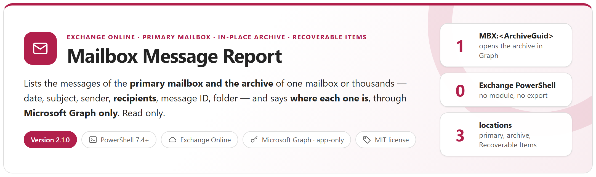
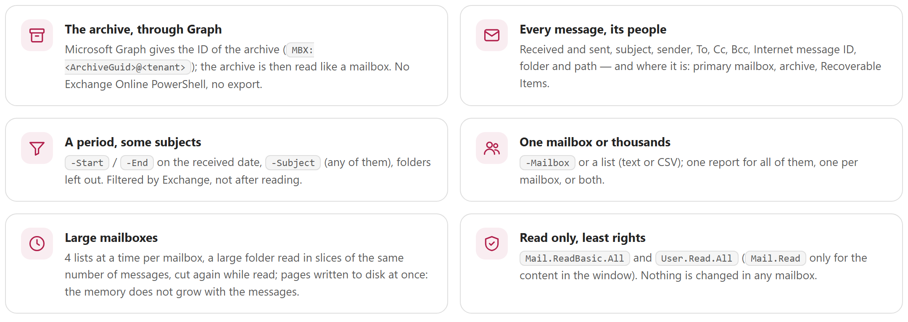
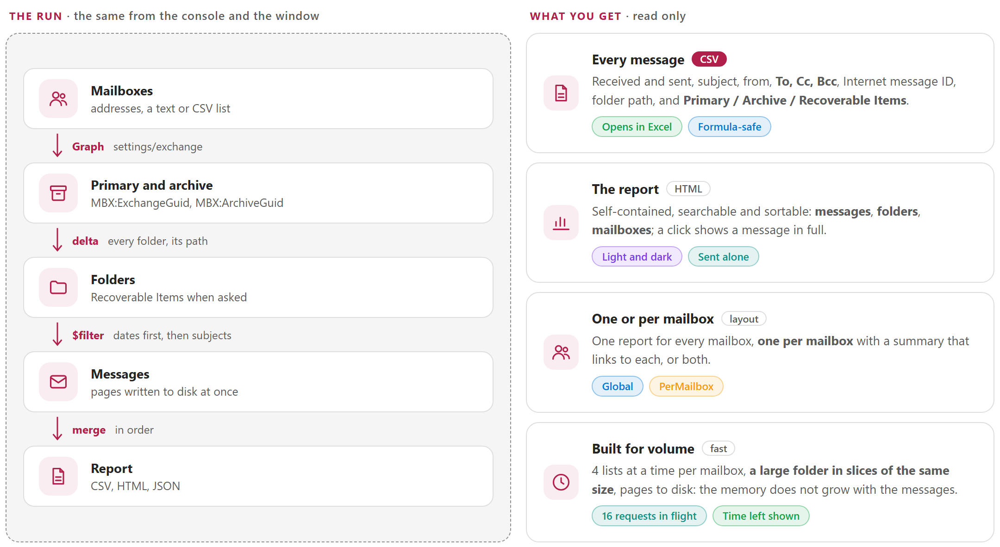
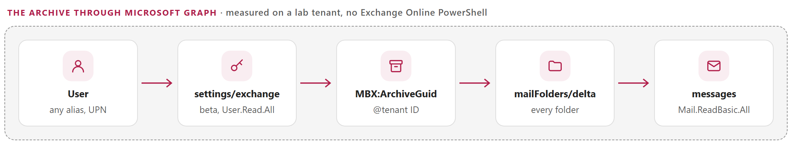
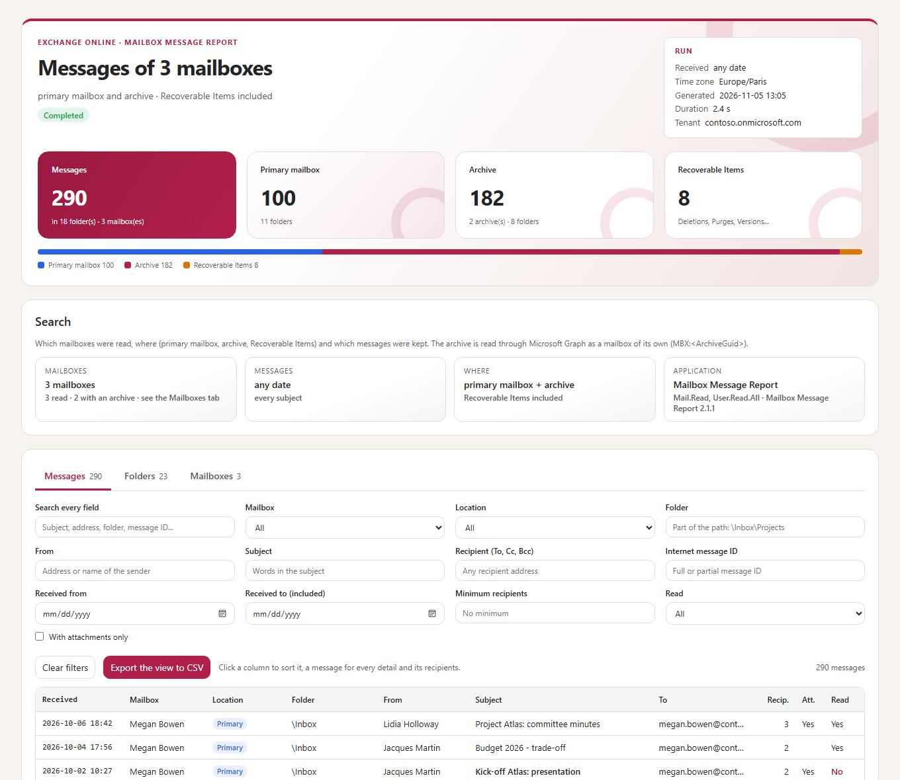
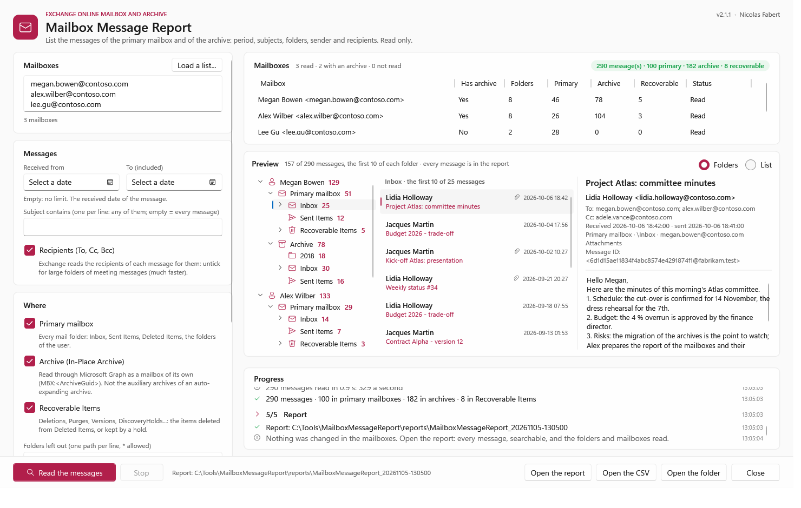
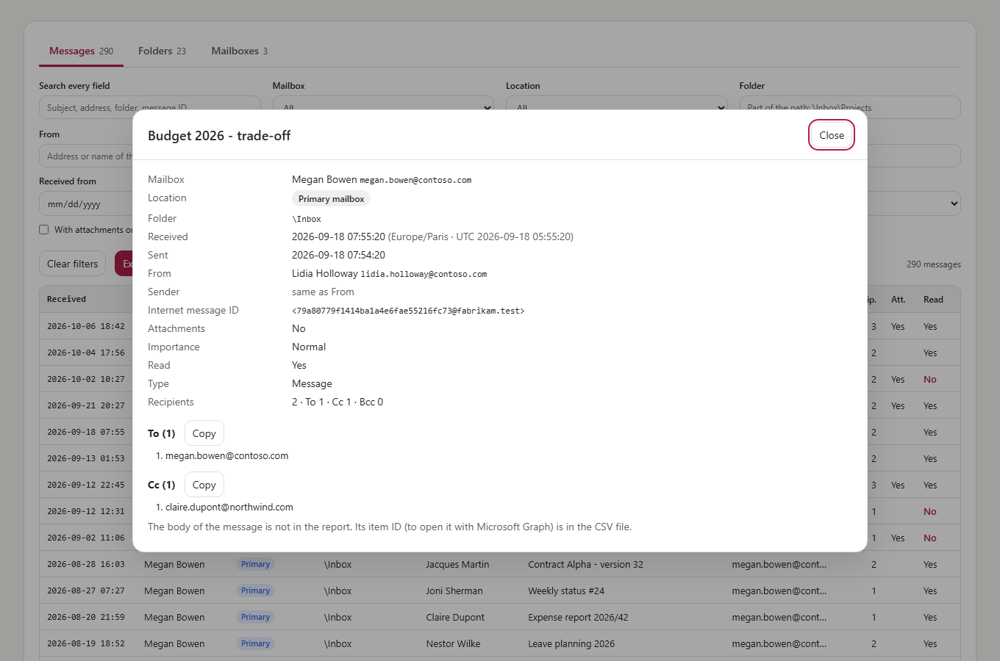
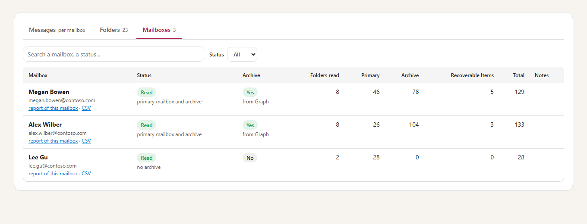
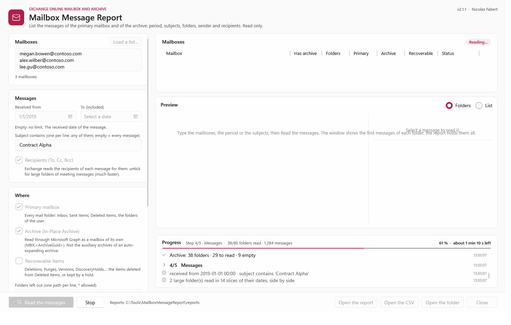
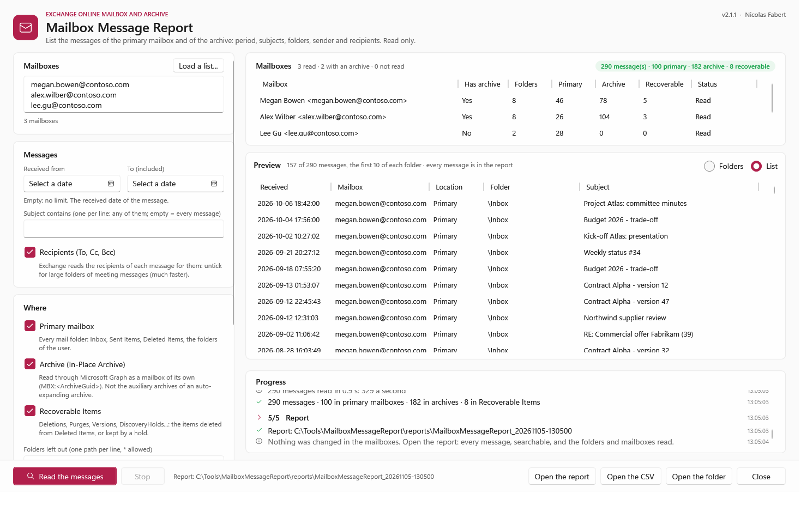

<p align="center">
  <picture>
    <source media="(prefers-color-scheme: dark)" srcset="package/docs/images/readme-banner-dark.png">
    
  </picture>
</p>

<p align="center">
  <a href="#how-it-works"><b>How it works</b></a> &nbsp;&middot;&nbsp;
  <a href="#the-archive-through-microsoft-graph"><b>The archive</b></a> &nbsp;&middot;&nbsp;
  <a href="#reports"><b>Reports</b></a> &nbsp;&middot;&nbsp;
  <a href="#get-started"><b>Get started</b></a> &nbsp;&middot;&nbsp;
  <a href="package/docs/MailboxMessageReport-UserGuide.md"><b>User guide</b></a> &nbsp;&middot;&nbsp;
  <a href="package/docs/MailboxMessageReport-Guide.md"><b>Developer guide</b></a>
</p>

> [!IMPORTANT]
> Files downloaded from the Internet may be blocked by Windows and fail to run. After you extract the release ZIP, unblock every file in the extracted folder:
>
> ```powershell
> Get-ChildItem "C:\Tools\MailboxMessageReport-2.1.1" -Recurse -File -Force | Unblock-File
> ```
>
> Replace the example path with the folder where you extracted the ZIP.
>
> Only `config\MailboxMessageReport.config.psd1`, `reports\` and `logs\` may change inside the tool folder; the tool refuses to start when another file is added, changed or missing. Keep your own files (mailbox lists, the certificate export) in a separate folder, for example `C:\Tools\MailboxMessageReport-data`.

## Why

*Which messages are in this archive? Did these people receive this contract, and where is it now — in the mailbox, in the archive, or deleted?* eDiscovery answers with an export, `Get-MailboxFolderStatistics` with counts, Outlook one mailbox at a time. None of them gives a plain list of the messages — date, subject, sender, recipients, folder — of the primary mailbox **and** of the archive, for many mailboxes at once.

The mail API of Microsoft Graph (the Microsoft web service that reads Microsoft 365 data) is documented for the primary mailbox only. But the In-Place Archive (the second, hidden mailbox of a user) is a mailbox of its own for Exchange Online: Graph gives its identifier and opens it with the same API. This tool builds on that — measured on a lab tenant — to list every message of the primary mailbox, the archive and Recoverable Items (the hidden folder that keeps deleted items), with **Microsoft Graph only**: no Exchange Online PowerShell, no export. **It only reads.**

<picture>
  <source media="(prefers-color-scheme: dark)" srcset="package/docs/images/readme-principles-dark.png">
  
</picture>

## How it works

<picture>
  <source media="(prefers-color-scheme: dark)" srcset="package/docs/images/readme-how-it-works-dark.png">
  
</picture>

- **The primary mailbox and the archive**: every mail folder of both, with its path (`\Inbox\Projects\Alpha`); **Recoverable Items** with `-IncludeRecoverableItems`. Each message says where it is: *Primary* or *Archive*, and *Recoverable Items* or not.
- **What is read**: received and sent date and time, subject, sender, **To, Cc, Bcc**, Internet message ID, folder and path, attachments, importance, type. The reports never hold the body or the attachments.
- **Filtered by Exchange**: the period (`-Start`, `-End`, received date) and the subjects (`-Subject`, any of them) are sent to Exchange as a filter, so only the matching messages are read. Folders can be left out (`-ExcludeFolder '\Junk Email'`).
- **One mailbox or thousands**: `-Mailbox` or a list (text or CSV); one report for all of them, **one per mailbox** (with a summary that links to each), or both.
- **Large mailboxes**: several requests run at a time, and each page is written to disk at once, so the memory does not grow with the number of messages. The console and the window give the time left.
- **The window, like Outlook**: the search typed in the window, then the folders of each mailbox and of its archive in a tree, the first 10 messages of each folder, and a **reading pane** with the recipients, the dates, the folder and the content of the message selected (read on demand, with `Mail.Read`, logged).
- **Application permissions of Microsoft Graph** and a certificate: `Mail.ReadBasic.All` and `User.Read.All` (`Mail.Read` only for the content in the reading pane); no user account, no module.

## The archive through Microsoft Graph

<picture>
  <source media="(prefers-color-scheme: dark)" srcset="package/docs/images/readme-archive-dark.png">
  
</picture>

- **No Exchange Online PowerShell**: with the permission `User.Read.All`, Graph gives the identifier of each archive. Without it, a CSV list can give the `ArchiveGuid` of each mailbox (an Exchange administrator exports it once).
- **`Mail.ReadBasic.All` is enough**: it reads the folders and every column of the report, in the archive and in Recoverable Items too.
- **Not the auxiliary archives** of an auto-expanding archive: a folder whose content moved there is reported *Failed*, the others are read. The archive identifier comes from a beta endpoint of Graph.

The calls, the measurements and the limits are in the [developer guide, chapter 3 and appendix C](package/docs/MailboxMessageReport-Guide.md#3-the-archive-through-microsoft-graph).

## Reports

<table>
  <tr>
    <td width="50%" valign="top"><a href="package/docs/images/report-overview.png"></a><br><sub><b>HTML report</b> &middot; every message, in a table with filters and sort; the folders and the mailboxes</sub></td>
    <td width="50%" valign="top"><a href="package/docs/images/gui-search-light.png"></a><br><sub><b>Window</b> &middot; the search on the left; the folders of the mailboxes and of their archive like Outlook, the first messages of each folder and a reading pane</sub></td>
  </tr>
  <tr>
    <td width="50%" valign="top"><a href="package/docs/images/report-message.png"></a><br><sub><b>A message</b> &middot; every column: dates, sender, recipients, Internet message ID, folder, location</sub></td>
    <td width="50%" valign="top"><a href="package/docs/images/report-mailboxes.png"></a><br><sub><b>One report per mailbox</b> &middot; the summary links to the report and the CSV file of each mailbox</sub></td>
  </tr>
</table>

<details>
<summary><b>A run in progress</b> &middot; the step, the part done and the time left; the window keeps answering</summary>
<br>
<a href="package/docs/images/gui-progress-light.png"></a>
</details>

<details>
<summary><b>The preview as a list</b> &middot; every message of the preview, sortable</summary>
<br>
<a href="package/docs/images/gui-list-light.png"></a>
</details>

Each run writes, in a folder of its own, `MailboxMessageReport-Messages.csv` (every message; a very long list of recipients is cut to fit an Excel cell, with their number), `-Mailboxes.csv`, `-Folders.csv`, `-Summary.json` and a self-contained HTML report with **every message** in a table with filters. With `-Layout PerMailbox` or `Both`, the CSV and HTML report of each mailbox are in `Mailboxes\`.

## Requirements

| Item | Requirement |
|---|---|
| Exchange | **Exchange Online**: the primary mailbox, its In-Place Archive (not the auxiliary archives) and Recoverable Items |
| PowerShell | **PowerShell 7.4 or later** (`pwsh`). Windows PowerShell 5.1 is not enough. 7.5 or later for the Windows 11 look of the window |
| Windows | Windows 10 / 11 or Windows Server 2016 to 2025; the window needs a desktop session, the command line runs anywhere (scheduled task) |
| Application | An application registered in Microsoft Entra (the Microsoft 365 identity service) with the **application** permissions `Mail.ReadBasic.All` and `User.Read.All` (an administrator approves them: *admin consent*), and a **certificate** whose private key is in the Windows store of the account that runs the tool. The user guide gives the steps. |
| Account | No Exchange or Entra role to run it: the application signs in. No module. |
| Network | HTTPS to `login.microsoftonline.com` and `graph.microsoft.com` |

## Get started

You need about 30 minutes the first time, most of it for the application registration. Each step says what to do, what you should see, and what to do if not.

**1. Download the release ZIP**

**Do:** open the [latest release](https://github.com/Nico77600/MailboxMessageReport/releases/latest) and download `MailboxMessageReport-2.1.1.zip` from the *Assets* list. Do not use the *Source code* archives: they do not hold the signed files.

**You should see:** a file of a few MB in your *Downloads* folder.

**If not:** the *Assets* list is collapsed; click *Assets* to open it.

**2. Extract the ZIP**

**Do:** extract the ZIP to `C:\Tools` (right-click, *Extract All*).

**You should see:** the folder `C:\Tools\MailboxMessageReport-2.1.1` with `Invoke-MailboxMessageReport.ps1` and a `README.md` in it.

**If not:** if `C:\Tools\MailboxMessageReport-2.1.1` holds only one more folder with the same name, move the inner folder to `C:\Tools`.

**3. Open PowerShell 7 in that folder and unblock the files**

**Do:** in File Explorer, open `C:\Tools\MailboxMessageReport-2.1.1`, click the address bar, type `pwsh` and press Enter. Then run:

```powershell
$PSVersionTable.PSVersion
Get-ChildItem . -Recurse -File -Force | Unblock-File
```

**You should see:** a version that starts with 7.4 or higher (7.4, 7.5...). The second command prints nothing.

**If not:** if `pwsh` is not recognized, or the version starts with 5, you opened Windows PowerShell 5.1, which is not enough. Install PowerShell 7 (`winget install Microsoft.PowerShell`), close the window and open a new one.

**4. Register the application, then fill the configuration**

**Do:** follow chapter 1 of the [user guide](package/docs/MailboxMessageReport-UserGuide.md#1-prerequisites) (`docs\MailboxMessageReport-UserGuide.html` in the ZIP): create the application in Microsoft Entra, add the two permissions, grant admin consent and upload the certificate. Then enter the tenant ID, the application ID and the certificate thumbprint:

```powershell
notepad .\config\MailboxMessageReport.config.psd1
```

**You should see:** `TenantId`, `AppId` and `CertificateThumbprint` filled in the file. Save it: the first run checks every value and lists every problem.

**If not:** the user guide gives, for each part, what you should see and what to do if not.

**5. Run a first report**

**Do:** read one mailbox. Nothing is ever changed in a mailbox.

```powershell
.\Invoke-MailboxMessageReport.ps1 -Mailbox megan.bowen@contoso.com
```

Replace the address with a mailbox of your tenant.

**You should see:** the steps in the console, a summary, and a new folder under `reports\` with `MailboxMessageReport.html` (open it in Microsoft Edge or Google Chrome) and the CSV files. Or open the window with `.\Invoke-MailboxMessageReport.ps1 -Gui`.

**If not:** the console shows the error in red. The table of messages at the end of the [user guide](package/docs/MailboxMessageReport-UserGuide.md#4-results) says what each one means.

**Everyday commands**

```powershell
# The archive only, over a period
.\Invoke-MailboxMessageReport.ps1 -Mailbox megan.bowen@contoso.com -Location Archive -Start 2019-01-01 -End 2019-12-31

# A team (a text or CSV file), a subject, deleted items too, one report per mailbox and one for all
.\Invoke-MailboxMessageReport.ps1 -MailboxFile C:\Tools\MailboxMessageReport-data\team.csv -Subject 'Contract Alpha' -IncludeRecoverableItems -Layout Both

# A very large mailbox: leave out the recipients to go faster
.\Invoke-MailboxMessageReport.ps1 -Mailbox room-paris-01@contoso.com -SkipRecipients
```

One command per everyday question — what is in this archive, who received this message and where it is now, what arrived in a period, a report for every mailbox of a team: see the [user guide](package/docs/MailboxMessageReport-UserGuide.md).

## Documentation

| Guide | Content |
|---|---|
| **[User guide](package/docs/MailboxMessageReport-UserGuide.md)** | For the people who run the tool: **prerequisites**, the one-time setup step by step and **everyday commands only** — the messages of an archive, where a message is, a period, a team, the archive without `User.Read.All`, a very large mailbox, the window, the results. |
| **[Developer guide](package/docs/MailboxMessageReport-Guide.md)** | Everything else: how it works, **how the archive is read through Microsoft Graph** (measured), what is read and how it is filtered, the application and the least permissions, every setting and parameter, the window, the report, the files produced, the architecture, performance and limits, tests, troubleshooting, security, the signing procedure. |

Both guides also exist as a single HTML file with a light and a dark theme, in the release ZIP (`docs\MailboxMessageReport-UserGuide.html`, `docs\MailboxMessageReport-Guide.html`): open them in your browser.

## For developers

The release ZIP is the way to use the tool. To work on the code, clone the repository: the `package` folder holds the run-time files, `tests` the offline tests, `tools` the documentation and package builders. See the [developer guide](package/docs/MailboxMessageReport-Guide.md#14-tests).

```powershell
git clone https://github.com/Nico77600/MailboxMessageReport.git
.\Run-Tests.ps1                                          # Pester 6.1+, a simulated Exchange Online tenant, no network
```

Start a clone with `-DevelopmentMode`: a source tree has no signed manifest, and once the signed manifest is committed `CHANGELOG.md` is still not in `package\`. A file you edited locally needs the manifest removed locally (delete `package\PackageIntegrity.psd1`, never commit that deletion). See the developer guide, chapter 15.

## License

[MIT](LICENSE).

## Disclaimer

This Script is a Personal project.
It's provided "AS-IS". It's not an official Microsoft product so no support can be expected from Microsoft.

As any scripts you must read carefully the documentation and test it first in a Test environment before any run in Production.

The archive is read through an ID that Microsoft Graph gives (a beta endpoint) and opens, but that its documentation does not describe for the archive: test it in your environment before production use. The reports contain personal data (addresses, subjects): store and share them accordingly.
