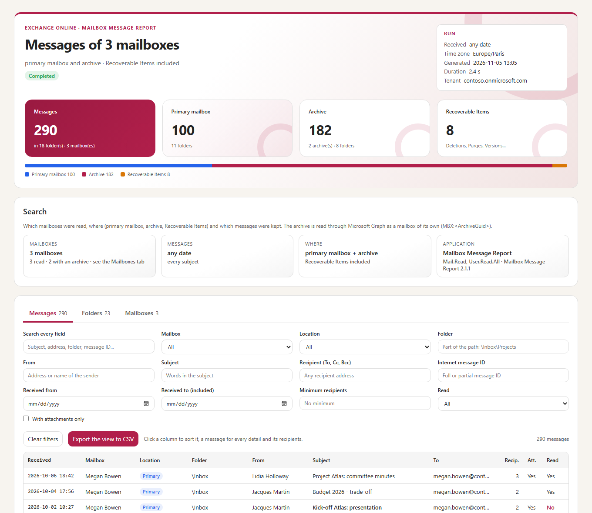
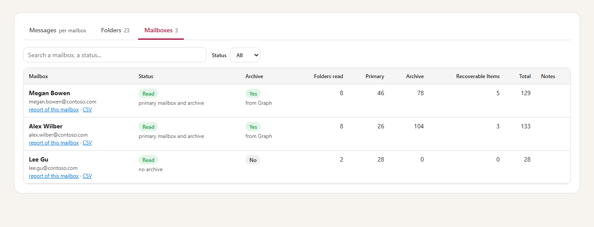
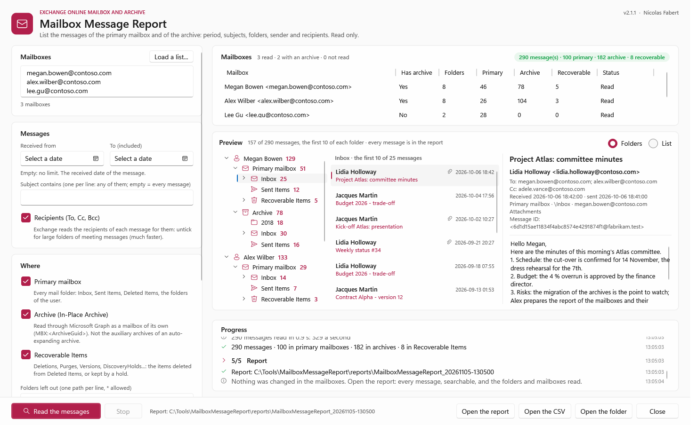
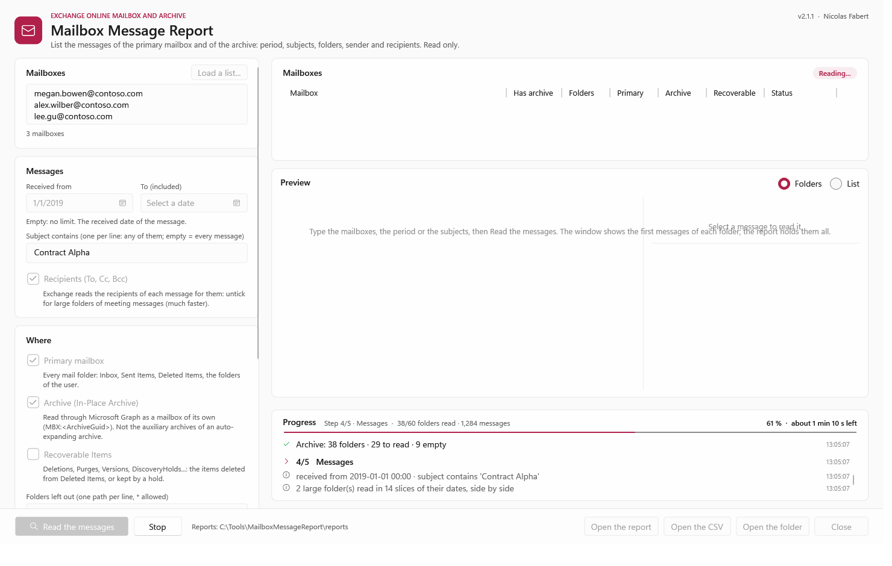
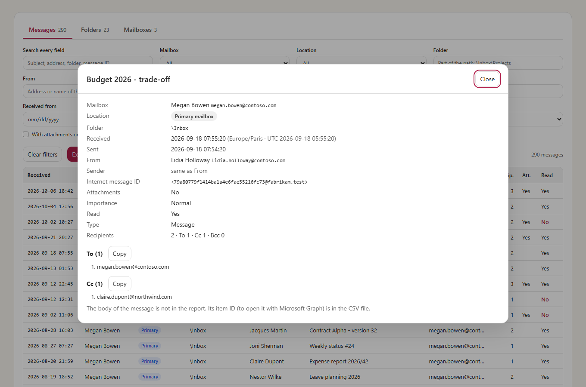

# Mailbox Message Report — User guide

> Follow the path, one step after the other: each setup step says **what to do**, **what you should see** and **what to do if not**. Then one command per everyday question: **which messages are in this archive?**, **did these people receive this message, and where is it now?**, **what arrived in this period?**, **a report for every mailbox of a team**. How the archive is read through Microsoft Graph, the rights in detail, the configuration, the report and the internals are in the [developer guide](MailboxMessageReport-Guide.md).

> [!IMPORTANT]
> Files downloaded from the Internet may be blocked by Windows and fail to run. After you extract the release ZIP, unblock every file in the extracted folder:
>
> ```powershell
> Get-ChildItem "C:\Tools\MailboxMessageReport-2.1.1" -Recurse -File -Force | Unblock-File
> ```
>
> Replace the example path with the folder where you extracted the ZIP.
>
> Only `config\MailboxMessageReport.config.psd1`, `reports\` and `logs\` may change inside the tool folder; the tool refuses to start when another file is added, changed or missing. Keep your own files (mailbox lists, the certificate export) in a separate folder, for example `C:\Tools\MailboxMessageReport-data`.

**Words used in this guide**

| Word | Meaning |
|---|---|
| Microsoft Graph | The Microsoft web service the tool uses to read Microsoft 365 data. |
| In-Place Archive | The second, hidden mailbox of a user, shown as *Online Archive* in Outlook. |
| Recoverable Items | A hidden folder of the mailbox that keeps deleted items and items under hold. |
| Microsoft Entra | The Microsoft 365 identity service. An *application* registered there is the identity the tool signs in with. |
| Application permission | A right given to the application itself, with no user signed in. |
| Admin consent | The approval of an administrator that makes the permissions of an application active. |
| Certificate and thumbprint | The certificate proves the identity of the application. The thumbprint is its short ID (40 characters). |
| Tenant ID | The ID of your Microsoft 365 organization. |
| UPN | The sign-in name of a user, in the form of an e-mail address. |
| Hold | A setting that keeps the items of a mailbox even if the user deletes them. |
| Auto-expanding archive | An archive that grows by adding *auxiliary* archives; the tool reads the main archive only. |
| SHA256 | A fingerprint of a file: two files with the same SHA256 are identical. |

```cards
checklist | Prerequisites | Chapter 1: PowerShell, the application and its certificate, then the one-time setup.
terminal | Everyday use | Chapter 2: one command per question, in the console or in the window.
filter | Choose the messages | Chapter 3: which mailboxes, where, which period, which subjects.
file | Results | Chapter 4: where the report is written, what it says, exit codes, the usual messages.
```

<!-- icon: checklist -->
## 1. Prerequisites

| Item | Requirement |
|---|---|
| Exchange | **Exchange Online** only: the primary mailbox, its In-Place Archive and Recoverable Items. Not the auxiliary archives of an auto-expanding archive. |
| PowerShell | **PowerShell 7.4 or later** (`pwsh`). Windows PowerShell 5.1 is not enough. With 7.5 and later the window has the Fluent look of Windows 11. |
| Windows | Windows 10 / 11, Windows Server 2016 to 2025. The window needs a desktop session; the command line runs anywhere (scheduled task, SSH). |
| Application | An **application registered in Microsoft Entra**, with the application permissions `Mail.ReadBasic.All` and `User.Read.All` (admin consent) and a **certificate** whose private key is in the certificate store of the account that runs the tool. Section 1.3 to 1.5 give the steps. |
| To register it | An Entra role that can create applications (*Application Administrator* or *Cloud Application Administrator*) and, for the admin consent, *Global Administrator* or *Privileged Role Administrator*. |
| Your account | **No Exchange or Entra role** to run it: the application signs in with its certificate. No Exchange Online PowerShell. |
| Network | HTTPS to `login.microsoftonline.com` and `graph.microsoft.com`. |

> [!WARNING]
> `Mail.ReadBasic.All` as an application permission reaches **every mailbox** of the tenant (never the body or the attachments of a message). Keep the certificate like an administrator password (private key not exportable, on the computer that runs the tool), or limit the application to some mailboxes with **RBAC for Applications**, an Exchange Online feature that gives an application a role on chosen mailboxes only (steps in [developer guide, chapter 5](MailboxMessageReport-Guide.md#5-application)).

### 1.1 Get the tool and open PowerShell 7

**Do:** download `MailboxMessageReport-2.1.1.zip` from the [Releases page](https://github.com/Nico77600/MailboxMessageReport/releases/latest) and extract it to `C:\Tools` (right-click, *Extract All*). In File Explorer, open `C:\Tools\MailboxMessageReport-2.1.1`, click the address bar, type `pwsh` and press Enter. A PowerShell 7 window opens in the right folder. Then run:

```powershell
$PSVersionTable.PSVersion
Get-ChildItem . -Recurse -File -Force | Unblock-File
```

**You should see:** a version that starts with 7.4 or higher, and nothing from the second command. Keep this window open for all the steps: every command of this guide is run from this folder.

**If not:** if `pwsh` is not recognized, or the version starts with 5, PowerShell 7 is not installed or you opened Windows PowerShell 5.1. Install it (`winget install Microsoft.PowerShell`), close the window and open a new one. If `C:\Tools\MailboxMessageReport-2.1.1` holds only one more folder with the same name, move the inner folder to `C:\Tools`.

> [!NOTE]
> **Check the download** (after you extract the ZIP in 1.1). Use the release ZIP `MailboxMessageReport-2.1.1.zip` from the [Releases page](https://github.com/Nico77600/MailboxMessageReport/releases/latest), not the *Source code* archives. The release page gives the SHA256 of the ZIP, and the PowerShell files carry the owner's signature (Nicolas Fabert). To check the ZIP and the script:
>
> ```powershell
> Get-FileHash $env:USERPROFILE\Downloads\MailboxMessageReport-2.1.1.zip -Algorithm SHA256
> Get-AuthenticodeSignature C:\Tools\MailboxMessageReport-2.1.1\Invoke-MailboxMessageReport.ps1 | Format-List Status, SignerCertificate
> ```
>
> **You should see:** the same SHA256 as on the release page, then `Status : Valid` and the signer Nicolas Fabert. The tool also checks all its files against a signed list each time it starts.
>
> **If not:** if it answers *Package integrity ... unexpected stable file*, you added a file to the tool folder: move your own files out of it. If it answers *SHA256 mismatch*, *missing* or *owner signature*, a file of the package was changed or is missing: download the ZIP again from the Releases page and extract it again.

### 1.2 Create the certificate

The certificate proves the identity of the application each time the tool signs in. It stays on this computer; only its public part (the `.cer` file) goes to Microsoft Entra.

**Do:** run these commands as the account that will run the tool, on the computer that will run it:

```powershell
New-Item -ItemType Directory -Force C:\Tools\MailboxMessageReport-data | Out-Null
$cert = New-SelfSignedCertificate -Subject 'CN=MailboxMessageReport' -CertStoreLocation Cert:\CurrentUser\My `
    -KeyExportPolicy NonExportable -KeySpec Signature -KeyAlgorithm RSA -KeyLength 2048 -NotAfter (Get-Date).AddYears(2)
Export-Certificate -Cert $cert -FilePath C:\Tools\MailboxMessageReport-data\MailboxMessageReport.cer
$cert.Thumbprint
```

**You should see:** a line of 40 letters and digits (the thumbprint), and the file `MailboxMessageReport.cer` in `C:\Tools\MailboxMessageReport-data`. Copy the thumbprint: you need it in 1.6.

**If not:** if PowerShell says the command is not found, you are not in PowerShell 7 (see 1.1). If it says access denied, open the window as the account that runs the tool, not as another one.

### 1.3 Register the application in Microsoft Entra

**Do:**

1. Open the [Microsoft Entra admin center](https://entra.microsoft.com) and sign in with an account that can create applications.
2. Go to *Identity* > *Applications* > *App registrations* and click *New registration*.
3. *Name*: `Mailbox Message Report`. *Supported account types*: *Accounts in this organizational directory only*. Leave *Redirect URI* empty.
4. Click *Register*.
5. On the *Overview* page, copy the *Application (client) ID* and the *Directory (tenant) ID*.

**You should see:** the *Overview* page of the new application with the two IDs, each a 36-character code with dashes.

**If not:** if *New registration* is greyed out or refused, your account is not allowed to create applications: ask an administrator to do 1.3 to 1.5, or to give you the *Application Administrator* role.

### 1.4 Give the application its two permissions

**Do:**

1. In the application, open *API permissions* and click *Add a permission*.
2. Choose *Microsoft Graph*, then *Application permissions* (not *Delegated permissions*).
3. Search `Mail.ReadBasic.All`, tick it. Search `User.Read.All`, tick it. Click *Add permissions*.
4. Click *Grant admin consent for* followed by your organization name, then *Yes*.

**You should see:** the two permissions listed with type *Application*, and a green check with *Granted for* your organization in the *Status* column of each.

**If not:** if the status is *Not granted* or the button is greyed out, an administrator with the *Global Administrator* or *Privileged Role Administrator* role must click *Grant admin consent*. Without it the tool stops with the message *no application permission Mail.ReadBasic.All* (chapter 4).

### 1.5 Upload the certificate

**Do:** in the application, open *Certificates & secrets*, then the *Certificates* tab, click *Upload certificate*, choose `MailboxMessageReport.cer` (created in 1.2) and click *Add*.

**You should see:** the certificate in the list, with a *Thumbprint* equal to the one printed in 1.2.

**If not:** if the thumbprint is different, you uploaded another file: upload `MailboxMessageReport.cer` again. A wrong certificate gives the error `AADSTS700027` at the first run.

### 1.6 Fill in the configuration

**Do:** open the configuration file and fill in four values:

```powershell
notepad .\config\MailboxMessageReport.config.psd1
```

| Setting | Value |
|---|---|
| `Tenant.TenantId` | the *Directory (tenant) ID* of 1.3 |
| `Tenant.Organization` | your organization, for example `contoso.onmicrosoft.com` |
| `Authentication.AppId` | the *Application (client) ID* of 1.3 |
| `Authentication.CertificateThumbprint` | the thumbprint of 1.2 |

**You should see:** the four values between quotes in the file. Save it.

**If not:** if you closed the window of 1.2, list the thumbprints again with `Get-ChildItem Cert:\CurrentUser\My`.

### 1.7 First run

**Do:** read the mailbox of one user, only since yesterday (replace the address with a mailbox of your tenant, and the date):

```powershell
.\Invoke-MailboxMessageReport.ps1 -Mailbox megan.bowen@contoso.com -Start 2026-11-04
```

**You should see:** step 1 shows the application and the permissions of its token, then the mailbox is read and a summary appears with a new folder under `reports\`. Open `MailboxMessageReport.html` in it. Nothing is ever changed in the mailbox.

**If not:** the error is shown in red. Look it up in the table of messages in chapter 4 (for example `AADSTS700016` for a wrong application ID, or *Certificate ... not found*).

> [!TIP]
> **Limit the mailboxes later.** Once the first run works, you can limit the application to some mailboxes (RBAC for Applications): [developer guide, chapter 5](MailboxMessageReport-Guide.md#5-application).

<!-- icon: terminal -->
## 2. Everyday use

Run the commands from the tool folder, in PowerShell 7. Each command reads the mailboxes and writes a report; **nothing is ever changed** in a mailbox. `-Gui` does the same in a window (2.7).

### 2.1 Which messages are in this archive?

```powershell
# The archive only
.\Invoke-MailboxMessageReport.ps1 -Mailbox megan.bowen@contoso.com -Location Archive

# The primary mailbox and the archive (default)
.\Invoke-MailboxMessageReport.ps1 -Mailbox megan.bowen@contoso.com
```



Open the HTML report: the **Messages** tab lists every message, with the *Location* (*Primary* or *Archive*) and the folder path; the **Folders** tab gives the number of items of each folder.

### 2.2 Did these people receive this message, and where is it now?

```powershell
.\Invoke-MailboxMessageReport.ps1 -Mailbox megan.bowen@contoso.com, alex.wilber@contoso.com -Subject 'Contract Alpha' -IncludeRecoverableItems
```

The subject *contains* the text, any case; several subjects: `-Subject 'Contract Alpha', 'Project Alpha'` (any of them). With `-IncludeRecoverableItems`, the messages deleted from *Deleted Items* (or kept by a hold) are listed too, with the path `\Recoverable Items\Deletions`. The *InternetMessageId* column is the same for one message in every mailbox: sort on it to see who has it, where.

### 2.3 What arrived in a period?

```powershell
.\Invoke-MailboxMessageReport.ps1 -Mailbox megan.bowen@contoso.com -Start 2026-09-01 -End 2026-09-30
```

The received date, in the time zone of the configuration (`Report.TimeZone`, Windows by default); the end date is included.

### 2.4 A report for every mailbox of a team

```powershell
.\Invoke-MailboxMessageReport.ps1 -MailboxFile C:\Tools\MailboxMessageReport-data\team.csv -Start 2026-01-01 -Layout Both
```



A text file with one address per line, or a CSV file (`PrimarySmtpAddress`, `UserPrincipalName`, `Mail`...). `-Layout Global` (default) writes one report for all the mailboxes, `PerMailbox` one report per mailbox (folder `Mailboxes\`, with a summary that links to each one), `Both` the two.

### 2.5 The archive without User.Read.All

```powershell
# Once, by an Exchange administrator: the ArchiveGuid of each mailbox
Get-EXOMailbox -ResultSize Unlimited -Archive -Properties ArchiveGuid | Select-Object PrimarySmtpAddress, ArchiveGuid | Export-Csv C:\Tools\MailboxMessageReport-data\archives.csv -NoTypeInformation

.\Invoke-MailboxMessageReport.ps1 -MailboxFile C:\Tools\MailboxMessageReport-data\archives.csv
```

With `User.Read.All`, the tool finds the archive itself in Microsoft Graph. Without it, the `ArchiveGuid` column of the list gives it.

### 2.6 A very large mailbox

```powershell
# The other columns first: much faster on large folders of meeting messages
.\Invoke-MailboxMessageReport.ps1 -Mailbox room-paris-01@contoso.com -SkipRecipients

# Leave out the folders you do not need
.\Invoke-MailboxMessageReport.ps1 -Mailbox megan.bowen@contoso.com -ExcludeFolder '\Junk Email', '\Deleted Items'
```

Exchange reads the recipients (To, Cc, Bcc) of each message one by one, so a folder of tens of thousands of meeting messages is much faster without them. A large folder is read in several parts at the same time. The progress line gives the share of the messages read, their number a second and the time left; the log gives the speed of each mailbox and the slowest folders.

### 2.7 In the window

```powershell
.\Invoke-MailboxMessageReport.ps1 -Gui
```





```steps
Mailboxes | Type the addresses (one per line), or *Load a list...* (text or CSV, with `ArchiveGuid` if you have it).
Messages | The period (empty: no limit), the subjects (one per line), the recipients; *Where*: primary mailbox, archive, Recoverable Items, folders left out; the report: CSV, HTML, global or per mailbox.
Read | *Read the messages*: the progress bar gives the step, the part done and the time left; *Stop* ends the run.
Look | The mailboxes read, and a preview: the first 10 messages of each folder. *Folders*: the folders of the mailbox and of its archive like in Outlook; select a folder, then a message: the reading pane shows its recipients, its dates, where it is and its content. *List*: every message of the preview in one list.
Report | *Open the report* (every message), *Open the CSV*, *Open the folder*.
```

> [!NOTE]
> The content of a message is read only when you select it, and only if the application has the permission `Mail.Read` (with `Mail.ReadBasic.All` the reading pane shows the rest). Each content read is written to the log. The reports never hold the content.

<!-- icon: filter -->
## 3. Choose the messages

| Parameter | Values | Example |
|---|---|---|
| `-Mailbox` | One or more addresses (any alias) or UPNs | `-Mailbox megan.bowen@contoso.com` |
| `-MailboxFile` | A list: text (one per line) or CSV (`ArchiveGuid` optional), by its absolute path in your data folder | `-MailboxFile C:\Tools\MailboxMessageReport-data\team.csv` |
| `-Location` | `Primary`, `Archive` or both (default) | `-Location Archive` |
| `-IncludeRecoverableItems` | Also Recoverable Items (deleted items, holds) | `-IncludeRecoverableItems` |
| `-Start` · `-End` | The received date (end included). Default: no limit | `-Start 2019-01-01 -End 2019-12-31` |
| `-Subject` | The subject contains this text; several: any of them | `-Subject 'Invoice', 'Receipt'` |
| `-ExcludeFolder` | Folders left out, by path (`*` allowed) | `-ExcludeFolder '\Junk Email'` |
| `-SkipRecipients` | Without To, Cc, Bcc: faster | `-SkipRecipients` |
| `-Layout` | `Global` (default), `PerMailbox`, `Both` | `-Layout PerMailbox` |
| `-Format` | `Csv`, `Html` or both (default) | `-Format Csv` |
| `-HtmlMaxMessages` | Lowers the limit of messages of the HTML report for one run (0 to 200,000); to raise it, change `Report.HtmlMaxMessages` (up to 2,000,000) | `-HtmlMaxMessages 100000` |
| `-Gui` | The window | `-Gui` |

<!-- icon: file -->
## 4. Results

Each run writes a new folder under `reports\` (`MailboxMessageReport_20261105-101500`). The console shows it at the end:



- **`MailboxMessageReport.html`** — the report: self-contained, it can be sent alone. Tiles (messages in the primary mailbox, the archive, Recoverable Items), the search, and the *Messages*, *Folders* and *Mailboxes* tabs. **Every message** is in it, compressed (up to 500,000, `Report.HtmlMaxMessages`; 1,000,000 messages: about 32 MB, open in 4 s):
  - filters together: every field, mailbox, location, folder, sender, subject, recipient (To, Cc, Bcc), message ID, received dates, a minimum of recipients, read or unread, with attachments;
  - columns: received, mailbox, location, folder, from, subject, to, recipients, attachments, read (an unread message in bold);
  - a click on a column sorts it; a click on a message gives every detail and **every recipient** (To, Cc, Bcc, with *Copy*);
  - *Export the view to CSV*: the messages filtered, in the order shown.
- **`MailboxMessageReport-Messages.csv`** — every message: mailbox, location, Recoverable Items, folder path and name, received, sent, subject, from, sender, to, cc, bcc, **number of recipients**, Internet message ID, attachments, importance, read, type. Separator `;`, opens directly in Excel. A list of thousands of recipients is cut to fit an Excel cell, with the number of the others (`… (+8,739 more)`): the HTML report has them all.
- **`MailboxMessageReport-Mailboxes.csv`**, **`-Folders.csv`** — one row per mailbox (archive, messages per location, why a mailbox was not read), one row per folder.
- **`MailboxMessageReport-Summary.json`** — the whole result, for scripts.
- **`Mailboxes\`** — with `-Layout PerMailbox` or `Both`: the CSV and HTML report of each mailbox.

| Mailbox status | Meaning |
|---|---|
| **Read** | Every folder asked for was read. |
| **Partial** | A folder (or the archive) could not be read: see *Notes*, and the *Folders* tab. |
| **Not read** | Mailbox on-premises or inactive, not a mailbox of the tenant, or access denied. |

| Exit code | Meaning |
|---|---|
| `0` | Completed. |
| `2` | Finished with warnings: a mailbox or a folder not read, an archive not known. The report says which. |
| `1` | Failed: read the error in red, and the log of the day in `logs\`. |

| Message | What to do |
|---|---|
| `AADSTS700016` · `AADSTS700027` | Application ID not in the tenant · certificate not uploaded to the application, or another one. |
| *Certificate ... not found* | The certificate is not in the store of the account that runs the tool: run 1.2 again as that account and upload the new `.cer` (1.5). |
| *no application permission Mail.ReadBasic.All* | Permission missing, or admin consent not granted (`Mail.Read` counts as well). |
| *archive not known* | `User.Read.All` missing: add it, or give the `ArchiveGuid` in a CSV list (2.5). |
| *mailbox inactive, soft-deleted or on-premises* | Graph cannot open this mailbox (hybrid: the mailbox is on-premises). |
| A folder of the archive *Failed* (*auxiliary archive*) | Auto-expanding archive: that folder is out of reach of the tool. |
| *Package integrity: unexpected stable file* | A file that is not part of the tool is in the tool folder. Move your own files (lists, certificates, copies of the configuration) out of it, for example to `C:\Tools\MailboxMessageReport-data`. |
| *Package integrity: verifier must have the trusted, timestamped owner signature* or *PackageIntegrity.psd1 is missing* | The tool folder is not the release ZIP: a file was re-saved or edited, or it comes from a *Source code* archive. Download `MailboxMessageReport-2.1.1.zip` from the Releases page and extract it again (1.1). |
| *Package integrity: SHA256 mismatch* or *missing inventory path* | A file of the tool was changed or is missing, or the tool is not the release ZIP. Download `MailboxMessageReport-2.1.1.zip` again from the Releases page and extract it again (1.1). |
| *access denied* | The application is limited to some mailboxes (RBAC for Applications). |
| *Graph answered a page cut short* in the log | Exchange Online ended a page early: the tool asks it again with fewer messages. *N message(s) left out* in the summary: Graph could not return them; the *Folders* tab says where. Many of them: `-SkipRecipients`. |
| The HTML report shows no message | With `-Layout PerMailbox`, open the report of each mailbox (*Mailboxes* tab). Otherwise open the report in Microsoft Edge or Google Chrome (not in Internet Explorer mode, not in the preview of OneDrive); the CSV file holds every message. |

Anything else: [developer guide, Appendix A — Troubleshooting](MailboxMessageReport-Guide.md#appendix-a---troubleshooting); every column of the report: [developer guide, chapter 4](MailboxMessageReport-Guide.md#4-what-is-read).
